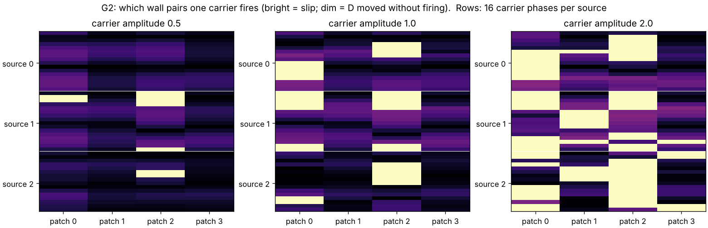
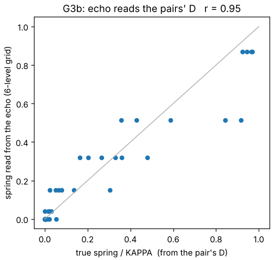

# 2729 — a cavity whose walls are phase pairs

**Oct 27 + Oct 29.** Oct 27 ([Kavitaatio](https://github.com/anttiluode/Kavitaatio), [WallMemoryLaw](https://github.com/anttiluode/WallMemoryLaw)) built a medium that *reads*: a ping crosses a damped, gapless cavity, and its echo at one receiver carries the wall state. Its walls, though, were written by hand. Oct 29 ([ChainNeuronsWithPhaseSpike](https://github.com/anttiluode/ChainNeuronsWithPhaseSpike), section T) found an element that *writes itself*: a near-complement pair whose stored difference phase D decides whether an input fires it, and whose firing moves D. But it lives in a sub-gap medium where nothing propagates. Each day had the half the other lacked.

2729 puts them together **without changing either physics**. The cavity is WallMemoryLaw's cavity, bit for bit. Each writable wall patch is one theta_neuron pair, each in its own private chains.World field. Built by Claude (Opus 5.5) on 31 Oct 2026.



## What was built

**Two bands.** The **cavity** (propagating) is the ellipse from `wml/cavity.py`: 96×96, wave speed 0.65, dt 0.5, damping 0.006, Neumann walls, the three Kavitaatio sources and the second-focus receiver. It has four writable patches at sectors 0, 2, 4, 6 of 8, as in ResonanceAsControlledMethod. The **pairs** (private, sub-gap) are one A (0.03) + X (0.11 + 0.015) pair per patch, each in its own N = 48 chains.World with m² = 0.02 and the pumped ear at 2Ω = 0.14, built exactly as `experiments/theta_neuron.py` builds it (pinned, noise 0).

**Two declared couplings.** These are the only new rules:

1. **Hear (cavity → pair).** Every step, the cavity displacement averaged over the patch's wall cells, times `g_in`, is injected into the pair's private field. It enters through the same source kernel theta_neuron uses for its drive, 2.5 cells from the pair.
2. **Wall (pair → cavity).** The patch's Robin spring is κ = 0.28 · (1 − cos D)/2. Here D is the pair's θ_A − θ_X minus that of an **unforced twin pair on the same clock** (see "Corrections on the way" for why the twin is needed). An unwritten pair leaves a Neumann wall; a pair moved by π gives Kavitaatio's full spring. This transducer is a modelling choice, not derived physics.

The pairs never emit into the cavity, and the cavity sees them only through κ. So everything a ping reads is what the pairs wrote, and everything a pair writes was delivered to it by the cavity.

**Actions.** A **read** is Kavitaatio's ping: a Gaussian pulse (σ 1.55) at one of three sources, heard for 350 steps at the receiver. The echo is the pinged trace minus an identical un-pinged twin, which subtracts the cavity's leftover ringing. A **write** is an 80-step carrier at 0.11 rad/step from one cavity source, at some phase and amplitude, followed by a 6000-step ringdown.

## Results

### Gate 0: both parents survive the merge
- With the pairs disconnected and the springs set by hand, the cavity equals WallMemoryLaw's `cavity.run` **exactly** (max difference 0, 3 wall words × 3 sources).
- A pair left alone keeps D exactly and never slips (3000 steps).
- Driven directly with theta_neuron's own pulse, it **does not fire at 0.04 and fires once at 0.06 and 0.2**, as in T2. The 0.2 pulse leaves D at −0.678 rad, which is Astra's −0.68.

### Coupling frozen before any gate
`g_in` was set by one rule: the strongest read ping, at any patch, delivers one tenth of the direct-drive threshold (0.05), measured as an equivalent 80-step carrier at 0.11 rad/step. Result: **g_in = 0.00617** (`results/calib.json`).

### G1: a read does not write — PASS
Thirty pings on a fresh wall, cycling the three sources: **no pair fired**, and every spring stayed below **0.4 % of KAPPA**. The largest single-ping change of D was 0.15 rad; the final |D| was ≤ 0.125 rad.

Reads were also checked on **written** walls, with a twin arm that was not pinged. On 4 written walls × 3 read cycles, read and quiet twins differ by at most **0.046 rad**, and nothing extra fires (`results/check_readwrit.json`). That fits the coupling rule: the pair is a narrowband receiver that integrates 0.11 rad/step, and a ping delivers little energy there.

### G2: one carrier from one source can address single walls
144 actions: 3 sources × 16 phases × amplitudes 0.5 / 1 / 2, each from a fresh wall.

| | |
|---|---|
| actions that fire anything | 7 / 48 at amp 0.5, 24 / 48 at amp 1, 43 / 48 at amp 2 |
| distinct fired sets | 10 of the 16 possible |
| patch fired **alone** by some action | patch 0: 12 actions · patch 1: 5 · patch 2: 23 · **patch 3: none** |
| when firing happens | **240 – 2690 steps after the carrier starts** (median 765); the carrier lasts 80 |
| D of a fired pair | always negative, −0.28 to −1.91 (median −0.87) |
| D of a pair that did not fire | |D| up to 0.95 rad (80 % under 0.34) |

**Addressing is by phase.** In the figure above, firing falls in contiguous bands of carrier phase. The same source fires one patch in one phase band and another patch in another, so the carrier's phase selects which wall is written.

**The cavity is the write integrator.** In 4/4 tested writes, no pair has fired when the 80-step carrier ends, and silencing the cavity at that moment stops all firing. Removing only its mean (the Neumann zero mode) still lets pairs fire in 3/4, but changes which ones in 3/4, so the zero mode takes part (`results/check_ringdown.json`). The pairs fire during the cavity's **ringdown**, which delivers the carrier for thousands of steps. That is why every write here waits 6000 steps (cavity amplitude ~e^(−0.0015 t)).

### G3: the echo reads D, not "fired or not"
For each of the 10 fired sets, one written wall was pinged from all three sources.

- **Binary read: 3/10.** "Which pairs fired" decoded with nearest template, every written patch at the median one-slip spring. It fails because a slip leaves the spring anywhere from 0.02 to 0.67 of KAPPA (D −0.28 to −1.91), a non-firing write can leave up to 0.21 (|D| 0.95), and the wobble (correction 4) moves it further. Firing is a winding of the locked sum phase, which the wall cannot see; the wall sees D, and D carries an *amount*.
- **Analog read: r = 0.95.** Nearest template on a 6-level spring grid per patch (1296 words), from the cavity alone. The spring read from the echo correlates **0.95** with the true spring set by the pair's D. The mean error is **0.067 of KAPPA**, under half a grid step.



### G4: the same action, the same wall, four times
Twelve firing actions from G2 were each applied four times to the same wall, every application on **matched clocks** (see correction 5). The control is a never-written wall, idled for the same time, realigned and given the same action: it reproduces the first outcome in **11/12** cases. The one miss is at the 0.08 rad clock tolerance. So what follows is the wall's state, not the clock.

| | |
|---|---|
| 2nd application fires the same patches as the 1st | **6 / 12** |
| 2nd application fires a patch the 1st did not | 4 / 12 |
| 4th application fires nothing at all | **5 / 12** |
| same patches fire on all four applications | 2 / 12 |

Typical sequences: `[0,0,1,0] → [1,0,0,0] → [1,0,0,0] → [0,0,0,0]` and `[1,1,0,1] → [1,0,1,0] → [0,0,0,0] → [0,0,0,0]`. The same action is routed by what is already stored, as T4 predicted for one pair: D gates firing, and firing moves D. Repeated, an action tends to use up the wall it writes. Twelve sequences are enough to show that the effect exists, not to estimate its rates.

## Corrections on the way (kept, because they are part of the result)

1. **"Retained D" needs a twin.** In a locked pair θ_A − θ_X rotates at the locked difference frequency: an idle pair's raw D moved 3.1 rad in 3000 steps. Every D here is measured against an unforced, noise-free twin stepped on the same clock.
2. **The first write table stopped too early.** It waited 1500 steps, while the cavity rings much longer. In that run, patch 3 looked individually addressable (one action) only because its partners had not fired yet. With the full ringdown, patch 3 is never fired alone. That version is kept in `results/v1_short_ringdown/`.
3. **"Reads destroy written walls" was wrong.** It looked that way because written walls kept changing between pings. The un-pinged twin did the same thing, and so did the same wall with the cavity silenced (quiet vs silenced ≤ 1e-4 rad, `results/check_readwrit.json`). The cause is item 4, not the ping.
4. **A fired pair's D wobbles.** The pair has a fixed limit-cycle orbit. After a slip it sits at a different point on it than its twin, so their difference oscillates at about A's locked frequency: period **195 steps**, depth growing with |D| (0.36 rad at D ≈ 0.36, 1.78 rad at D ≈ −2.36). The **cycle mean holds**: its first and second halves over 16,000 steps agree to 0.005 rad (`results/check_wobble.json`). So the stored quantity is the cycle-mean D. The instantaneous-D transducer used here makes the wall breathe, which costs the analog read some accuracy. It also means single snapshots of D after a slip (−0.99, −0.68, −1.21 in different runs) are not a "quantum"; compare cycle means.
5. **An action is only repeatable on matched clocks.** Under lock, A runs at **0.016 rad/step**, not 0.03, which is incommensurate with the 0.14 pump. A fresh wall is the same state only when pump phase and pair phase return together. Without that, the same action on a *never-written* wall 6080 steps later reproduced the first outcome in only **8/36** cases. That first G4 measured mostly the clock, and it is kept as `results/g4_repeat_v1_confounded.json` and `g4_clock_v1.json`. With both clocks matched to within 0.08 rad, a fresh wall repeats an action **16/16** if the carrier is timed from its own start, 15/16 if it is tied to the twin pair's phase, and only 2/16 if it keeps the absolute-time carrier, which is a third clock (`results/check_clock.json`).

## Ledger

**Verified**
- Both parents reproduce exactly inside the merge (Gate 0).
- Reads do not write: 30 pings, no slips, springs < 0.4 % of KAPPA; read vs quiet twins on written walls ≤ 0.046 rad.
- One carrier from one source writes single walls, selected by phase (3 of 4 patches individually; 10 of 16 sets reachable in one action).
- Writing happens in the cavity's ringdown, not during the carrier.
- The echo reads each pair's D as an analog spring, r = 0.95.
- The same action on the same wall is routed by what is stored: 6/12 second applications differ from the first, 5/12 walls go silent by the fourth (clock-matched, control 11/12).

**Failed**
- Binary read of "which pairs fired": 3/10.
- Patch 3 cannot be fired alone by any single action tested.
- The first G4 (no clock matching) measured mostly the clock: its own control (a never-written wall at the later time) reproduced the first outcome in only 8/36.

**Not done**
- Noise (every run here has phase noise 0). Relay between pairs. Moving or bonded chains. Larger K, other cavity shapes, or a learned write policy. A cycle-averaging transducer (κ from the 195-step mean of D), which should remove the breathing. Erasing (driving D back toward 0).

## Run

```
pip install numpy torch matplotlib pytest
python -m pytest -q tests          # merge changes neither parent (~1 min)
python gate0.py                    # Gate 0
python gates.py calib read         # freeze g_in, G1
python gates.py write              # G2, 144 actions (~30 min on 2 cores)
python gates.py decode             # G3
python gates.py repeat2            # G4 on matched clocks (~15 min)
python checks.py ringdown readwrit wobble clock   # receipts for the mechanism claims (~30 min)
python make_figures.py
```

`twoband.py` is the whole merge (one class). `chains/` and `wml/cavity.py` are unchanged copies; see `SOURCE_PROVENANCE.md`.
